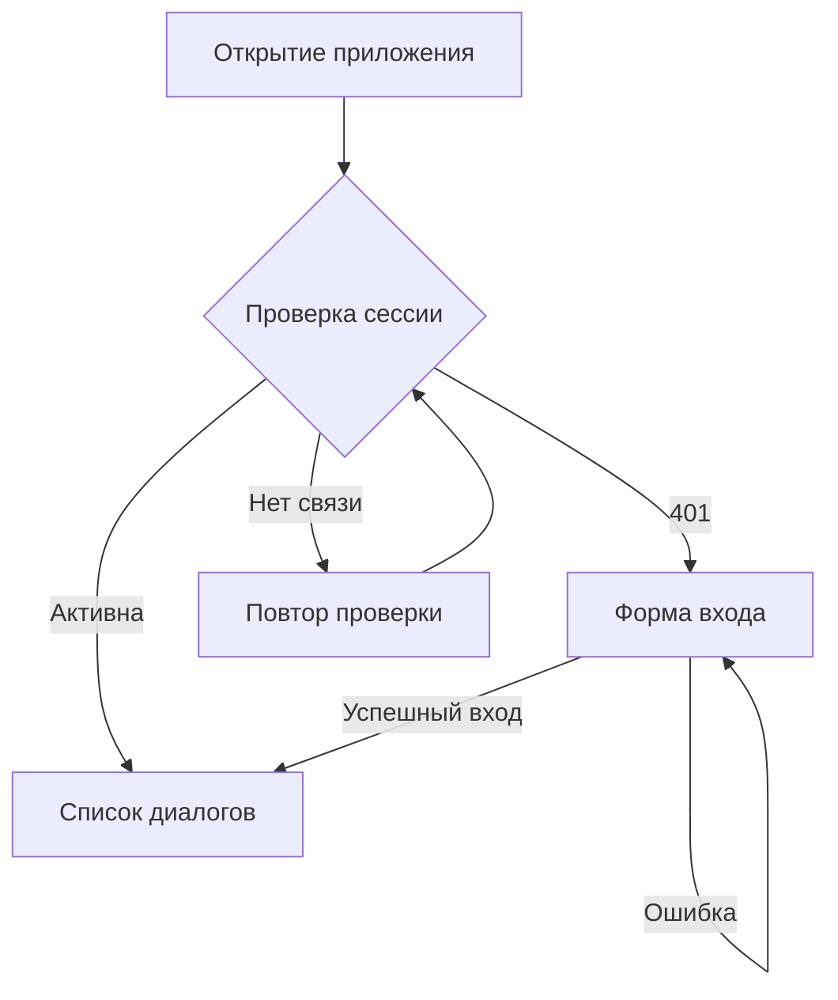

# Регистрация, вход и выход

Материалы для MSG-029 / [issue #3](https://github.com/OutSiders-Techniki/messenger-frontend/issues/3). Статус: подготовлено для согласования с бэкендом и фронтендом; реализация и согласование ещё не завершены.

Основа: «Приватный web-мессенджер: план проекта v1», переданный заказчику, и ответы на вопросы 29–34. Аккаунт создаётся без телефона и email. Сервер выдаёт публичный ID, пользователь задаёт пароль. Пароль аккаунта и ключ диалога — разные сущности.

## Сценарий регистрации

Предусловие: пользователь не авторизован. Форма содержит пароль, повтор пароля, переключатель видимости и кнопку «Создать аккаунт». Повтор пароля проверяется только локально. Правила длины и сложности должны совпадать с серверной политикой; их численные значения пока не утверждены.

1. Пользователь вводит пароль. Пустые поля и несовпадение паролей показываются возле соответствующего поля; запрос не отправляется.
2. При отправке кнопка блокируется, появляется «Создаём аккаунт…». Пароли не попадают в URL, аналитику или логи.
3. Сервер генерирует уникальный читаемый ID без I, O, 0, 1. Коллизию при генерации решает сервер, пользователь не придумывает другой ID.
4. После успеха показывается отдельный экран «Аккаунт создан» с ID, кнопкой «Скопировать ID» и текстом «Сохраните ID: он нужен для входа и поиска вас собеседником». При отказе Clipboard API ID остаётся выделяемым для ручного копирования. ID не является ключом диалога.
5. Предложение для MVP: регистрация не создаёт сессию; кнопка «Перейти ко входу» переносит ID в форму входа, пароль не переносится. Если бэкенд выберет автоматический вход, согласовать изменение этого шага до реализации.
6. После сетевого тайм-аута не повторять регистрацию автоматически: предыдущий запрос мог создать аккаунт. Показать «Не удалось подтвердить создание аккаунта». Надёжное восстановление результата без раскрытия пароля требует отдельного согласования идемпотентности регистрации с бэкендом.

## Сценарий входа

Форма: «Ваш ID», «Пароль», переключатель видимости, «Войти», ссылка «Создать аккаунт». Для ID — autocomplete=username, для пароля — current-password; при регистрации — new-password. Поля имеют видимые подписи, ошибки доступны с клавиатуры и через aria-live. Пароль не обрезать и не менять регистр. Правила нормализации ID согласовать с сервером; не заменять похожие символы молча.

1. При открытии приложения проверить текущую сессию. До ответа не показывать старую переписку.
2. Активная сессия открывает список диалогов; 401 открывает вход. Сетевой сбой показывает повтор проверки, а не утверждение «сессия истекла».
3. При отправке входа блокировать повторное нажатие. Cookie получает браузер; JavaScript не читает HttpOnly-cookie.
4. После успеха загрузить текущего пользователя, затем его диалоги. Ключи выбираются только по паре «пользователь + диалог».
5. Неверный ID и неверный пароль показывают одинаковую ошибку «Неверный ID или пароль» без подтверждения существования аккаунта.
6. При переходе в диалог без ключа показать «Введите ключ диалога». Пароль аккаунта не расшифровывает переписку. Утерянные ключи не восстанавливаются сервером.

## Выход и истечение сессии

При явном выходе сразу закрыть доступ к переписке, остановить SignalR, отменить запросы, очистить состояние сообщений и ссылки на ключи в памяти, удалить превью и отозвать object URL. Поздние ответы не должны возвращать старые данные: использовать поколение сессии или аналогичный механизм. Невозможно обещать физическое обнуление всей памяти JavaScript — речь об удалении доступного приложению состояния.

Отправить запрос завершения серверной сессии. Успех либо уже недействительная сессия переводят на вход. При сетевой ошибке локальные данные уже скрыты, но показать «Данные на этом экране очищены. Завершение сессии на сервере не подтверждено» и кнопку повтора; не заявлять успешный выход и не открывать автоматически чат по оставшейся cookie. Cookie HttpOnly нельзя удалить клиентским JavaScript.

Предложение: обычный выход сохраняет ранее разрешённые ключи в IndexedDB, но очищает память. Отдельное действие «Выйти и удалить сохранённые ключи этого аккаунта с устройства» очищает IndexedDB только этого аккаунта, с подтверждением потери локальных ключей. Режим «не запоминать» никогда не записывает ключ. Такое разделение следует из требования сохранять ключи между сессиями и требует подтверждения команды.

Выход синхронизируется между вкладками текущего аккаунта; в каждой очищаются память и UI. При 401 от защищённого запроса используется та же локальная очистка. После reconnect клиент заново синхронизирует сообщения и удаления с сервером.

## Макеты состава экранов

| Экран | Сверху вниз | Основное действие | Ошибка / состояние |
|---|---|---|---|
| Регистрация | Заголовок, пояснение про ID, пароль, повтор, сообщение ошибки | Создать аккаунт | Проверка полей / отправка / ошибка |
| Аккаунт создан | Заголовок, публичный ID, пояснение о сохранении | Скопировать ID; перейти ко входу | Успех копирования / ручное копирование |
| Вход | Заголовок, ID, пароль, сообщение ошибки | Войти | Отправка / неверные данные / ограничение частоты |
| Диалоги | ID текущего пользователя, поиск, список, меню аккаунта | Открыть диалог | Загрузка / пусто / ошибка / истёкшая сессия |
| Выход без связи | Подтверждение локальной очистки, статус серверной сессии | Повторить выход | Не выдавать локальную очистку за серверный выход |

Это спецификация UX-flow для вёрстки Андреем, не утверждённый визуальный дизайн.

## Предлагаемый API для согласования

Названия DTO, URL current-user и статусы ниже — предложения, а не сведения о реализованном API. Сервер пока представлен README в main. Пароль передаётся только по HTTPS; в локальном браузерном тесте использовать localhost. Same-origin размещение упрощает cookie и CORS; защиту от CSRF бэкенд определяет явно для всех изменяющих запросов, не полагаясь только на HttpOnly.

| Операция | Запрос | Успех | Ошибки |
|---|---|---|---|
| Регистрация | POST /auth/register, `{password}` | 201, `{publicId}` | 400: поля; 429: лимит; 5xx: ошибка сервера |
| Вход | POST /auth/login, `{publicId,password}` | 200, `{publicId}` + session cookie | 400: формат; 401: неверные данные; 429: лимит |
| Текущий пользователь | GET /auth/me | 200, `{publicId}` | 401: нет сессии |
| Выход | POST /auth/logout | 204, сессия отозвана, cookie истекла | 401: сессия уже недействительна; сетевой сбой: результат неизвестен |

Общий формат ошибки предложен как `{code, message, fieldErrors?}`; UI использует безопасные локальные тексты, не HTML от сервера. Для 429 учитывать Retry-After, если сервер его вернул. Кнопка повтора доступна после ожидания. Ошибки 403 не маскировать под успешную операцию.

## Приёмка

- [ ] Регистрация без телефона/email; ID генерируется сервером и доступен для ручного копирования.
- [ ] Несовпадающие пароли не отправляются; при двойном клике один запрос.
- [ ] Вход с неверным ID и неверным паролем даёт одну и ту же ошибку.
- [ ] 429, отсутствие сети и 5xx различимы; пароли не логируются и не сохраняются приложением.
- [ ] Вход пользователя B не подгружает ключи и сообщения пользователя A.
- [ ] После выхода, 401 и позднего ответа API старые сообщения не возвращаются.
- [ ] Вторая открытая вкладка очищается при выходе; выход без сети не считается подтверждённым на сервере.
- [ ] Frontend и backend согласовали DTO, политику пароля, регистрацию без авто-входа, идемпотентность регистрации и поведение IndexedDB при выходе.

Связанные задачи: backend [#33](https://github.com/OutSiders-Techniki/messenger-backend/issues/33), frontend MSG-041/042 и MSG-039. Согласование проводит Леонид с Валерием и Андреем; сценарии проверяет Александр. Согласование этим документом не подразумевается.
